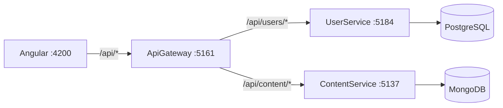

# CleanArchDemo

Two .NET 10 microservices built with Clean Architecture, a YARP API gateway, and an Angular 21 frontend.



- **UserService**: registration, login, issues JWT. PostgreSQL + EF Core.
- **ContentService**: articles and videos, JWT-protected. MongoDB.
- **ApiGateway**: single entry point (YARP reverse proxy).
- **frontend**: Angular client with ngx-toastr notifications.

## Tech stack

.NET 10 · ASP.NET Core · MediatR · FluentValidation · EF Core / Npgsql · MongoDB.Driver · JWT + BCrypt · YARP · Swagger · Angular 21 (standalone, signals, zoneless) · ngx-toastr

## Getting started

**Prerequisites:** .NET 10 SDK, Node.js 24, PostgreSQL, Docker (for MongoDB).

1. Start MongoDB:

   ```bash
   docker run -d --name contentplatform-mongo -p 27017:27017 mongo:7
   ```

2. Configure secrets (`Jwt:*` values must match in both services, secret ≥ 32 chars):

   ```bash
   cd src/UserService/UserService.API
   dotnet user-secrets set "ConnectionStrings:Default" "Host=localhost;Port=5432;Database=UserServiceDb;Username=postgres;Password=<password>"
   dotnet user-secrets set "Jwt:Secret" "<random 32+ char string>"
   dotnet user-secrets set "Jwt:Issuer" "UserService"
   dotnet user-secrets set "Jwt:Audience" "MyApp"

   cd ../../ContentService/ContentService.API
   dotnet user-secrets set "MongoDB:ConnectionString" "mongodb://localhost:27017"
   dotnet user-secrets set "MongoDB:DatabaseName" "ContentServiceDb"
   dotnet user-secrets set "Jwt:Secret" "<same as above>"
   dotnet user-secrets set "Jwt:Issuer" "UserService"
   dotnet user-secrets set "Jwt:Audience" "MyApp"
   ```

3. Create the database:

   ```bash
   dotnet ef database update --project src/UserService/UserService.Infrastructure --startup-project src/UserService/UserService.API
   ```

4. Run the backend (or use the multi-startup profile in Visual Studio):

   ```bash
   dotnet run --project src/UserService/UserService.API --launch-profile http
   dotnet run --project src/ContentService/ContentService.API --launch-profile http
   dotnet run --project src/ApiGateway --launch-profile http
   ```

5. Run the frontend and open http://localhost:4200:

   ```bash
   cd frontend
   npm install
   npm start
   ```

## API

| Method | Path | Auth |
|---|---|---|
| POST | `/api/users/register` | — |
| POST | `/api/users/login` | — |
| GET | `/api/content` | Bearer |
| POST | `/api/content/article` | Bearer |
| POST | `/api/content/video` | Bearer |

Swagger: http://localhost:5184/swagger, http://localhost:5137/swagger. Sample requests: [`src/ApiGateway/ApiGateway.http`](src/ApiGateway/ApiGateway.http).

## Project structure

```
src/
  ApiGateway/
  UserService/      API · Application · Domain · Infrastructure
  ContentService/   API · Application · Domain · Infrastructure
frontend/           Angular app
```
