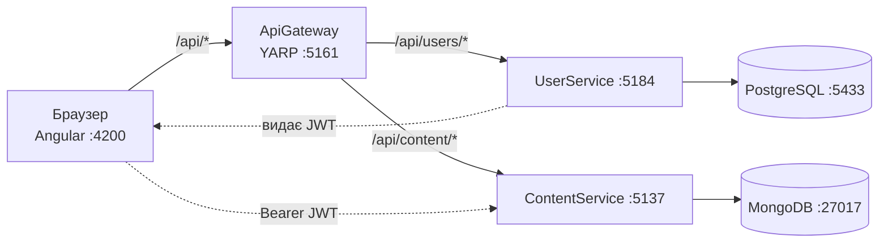

# CleanArchDemo

Навчальний проєкт: два мікросервіси на **.NET 10** за принципами **Clean Architecture**,
**API Gateway** на YARP і фронтенд на **Angular 21**.

- **UserService** — реєстрація, вхід, видача JWT. PostgreSQL + EF Core.
- **ContentService** — статті та відео. MongoDB. Доступ лише з JWT.
- **ApiGateway** — єдина точка входу, проксує запити до сервісів.
- **frontend** — Angular-клієнт з ngx-toastr.



## Швидкий старт

Покроково з демо-акаунтом: **[RUNNING.md](RUNNING.md)**.

Коротко: бази даних → три сервіси (профіль **New Profile** у Visual Studio) → `cd frontend; npm start` → http://localhost:4200.

## Документація

### З чого почати читати

Якщо ви вперше бачите проєкт, читайте в такому порядку:

1. **[Концепції простими словами](docs/concepts.md)** — що таке Clean Architecture, DI, CQRS, MediatR, JWT, DTO і навіщо кожне з них тут.
2. **[Архітектура](docs/architecture.md)** — як ці ідеї складені в систему.
3. **[Покроковий розбір коду](docs/walkthrough.md)** — реєстрація, вхід, створення статті й отримання списку від кнопки до бази, з кодом кожного файлу.
4. **[Program.cs і DI](docs/startup.md)** — як сервіси збираються при старті.
5. Далі — довідкові документи за потребою.

### Усі документи

| Документ | Про що |
|---|---|
| [Концепції](docs/concepts.md) | 17 ідей, на яких побудований проєкт, з прикладами з коду |
| [Покроковий розбір](docs/walkthrough.md) | 4 сценарії через усі файли; що відбувається при помилці |
| [Program.cs і DI](docs/startup.md) | Рядок за рядком: реєстрація сервісів, порядок middleware, конфігурація, карта залежностей |
| [Архітектура](docs/architecture.md) | Шари, залежності, CQRS, MediatR, потік запиту, ключові рішення |
| [UserService](docs/user-service.md) | Користувачі, паролі, JWT, PostgreSQL, міграції |
| [ContentService](docs/content-service.md) | Статті й відео, MongoDB, поліморфізм, DTO |
| [ApiGateway](docs/api-gateway.md) | Маршрути YARP, як додати новий сервіс |
| [Довідник API](docs/api-reference.md) | Усі ендпойнти, запити, відповіді, коди помилок |
| [Фронтенд](docs/frontend.md) | Структура Angular-застосунку, auth, interceptor-и, toastr |
| [Розробка](docs/development.md) | Налаштування, секрети, міграції, як додати фічу, відомі обмеження |
| [Якщо щось не працює](docs/troubleshooting.md) | Типові помилки: симптом, причина, рішення |

## Технології

| Шар | Що використано |
|---|---|
| Бекенд | .NET 10, ASP.NET Core, MediatR 15, FluentValidation 12 |
| Дані | EF Core 10 + Npgsql (PostgreSQL), MongoDB.Driver 3 |
| Безпека | JWT (HS256), BCrypt для паролів |
| Gateway | YARP 2.3 |
| Документація API | Swashbuckle (Swagger UI) |
| Фронтенд | Angular 21 (standalone, signals, zoneless), ngx-toastr 20 |

## Структура репозиторію

```
CleanArchDemo/
├── src/
│   ├── ApiGateway/                         YARP reverse proxy
│   ├── UserService/
│   │   ├── UserService.API/                контролери, middleware, Program.cs
│   │   ├── UserService.Application/        команди, валідатори, інтерфейси
│   │   ├── UserService.Domain/             сутність User, UserId, IUserRepository
│   │   └── UserService.Infrastructure/     EF Core, репозиторій, JWT, BCrypt, міграції
│   └── ContentService/
│       ├── ContentService.API/             контролер, middleware, Program.cs
│       ├── ContentService.Application/     команди, запит, DTO, валідатори
│       ├── ContentService.Domain/          ContentItem, Article, Video
│       └── ContentService.Infrastructure/  MongoDB, репозиторій
├── frontend/                               Angular-клієнт
├── docs/                                   ця документація
├── README.md
├── RUNNING.md                              як запустити і перевірити
└── CleanArchDemo.slnx                      рішення (формат .slnx)
```

Папки на диску збігаються з папками в Solution Explorer Visual Studio.
Документація теж видна у Visual Studio, у вузлі **Solution Items**.
