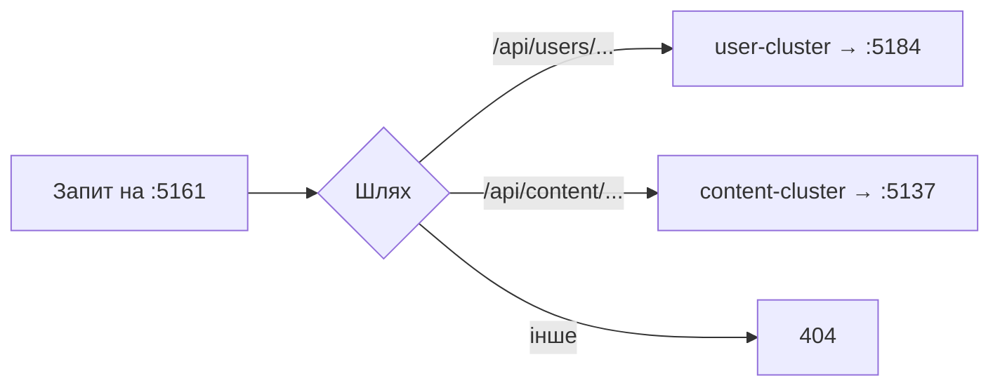

# ApiGateway

← [README](../README.md) · [Архітектура](architecture.md)

Reverse proxy на **YARP**. Клієнт знає лише одну адресу, `http://localhost:5161`, а gateway вирішує,
у який сервіс передати запит.

## Увесь код

```csharp
var builder = WebApplication.CreateBuilder(args);

builder.Services.AddReverseProxy()
    .LoadFromConfig(builder.Configuration.GetSection("ReverseProxy"));

var app = builder.Build();
app.MapReverseProxy();
await app.RunAsync();
```

Уся логіка маршрутизації лежить в `appsettings.json`.

## Маршрути

| Route | Шаблон шляху | Cluster | Куди |
|---|---|---|---|
| `user-route` | `/api/users/{**catch-all}` | `user-cluster` | http://localhost:5184 |
| `content-route` | `/api/content/{**catch-all}` | `content-cluster` | http://localhost:5137 |

- `{**catch-all}` збігається з будь-яким хвостом шляху, **включно з порожнім**,
  тому `/api/content` теж потрапляє в `content-route`.
- Шлях передається **без змін**: `/api/content/article` на gateway = `/api/content/article` у сервісі.
- Заголовок `Authorization` проходить як є. Gateway **не перевіряє** JWT, це робить ContentService.



## Як додати новий сервіс

Наприклад, `CommentService` на порту 5200:

```json
"Routes": {
  "comment-route": {
    "ClusterId": "comment-cluster",
    "Match": { "Path": "/api/comments/{**catch-all}" }
  }
},
"Clusters": {
  "comment-cluster": {
    "Destinations": {
      "destination1": { "Address": "http://localhost:5200" }
    }
  }
}
```

Перекомпіляція не потрібна: YARP підхоплює зміни `appsettings.json` на льоту.

## Перевизначення адрес

Будь-яке значення можна перевизначити аргументом командного рядка або змінною середовища, не чіпаючи файл:

```powershell
dotnet run --project src/ApiGateway --launch-profile http -- --ReverseProxy:Clusters:user-cluster:Destinations:destination1:Address=http://localhost:5901
```

Так зручно запускати другу копію системи на інших портах для тестів.

## Чого тут немає (і що можна додати)

| Можливість | Як у YARP |
|---|---|
| Перевірка JWT на вході | `AddAuthentication().AddJwtBearer(...)` + `AuthorizationPolicy` у route |
| CORS для продакшену | `AddCors` + `app.UseCors()` перед `MapReverseProxy()` |
| Rate limiting | `AddRateLimiter` + `RateLimiterPolicy` у route |
| Кілька інстансів сервісу | кілька `Destinations` + `LoadBalancingPolicy` |
| Health checks | `HealthCheck` у налаштуваннях cluster |

Під час розробки CORS не потрібен: Angular dev-server сам проксує `/api` на gateway (див. [Фронтенд](frontend.md)).
