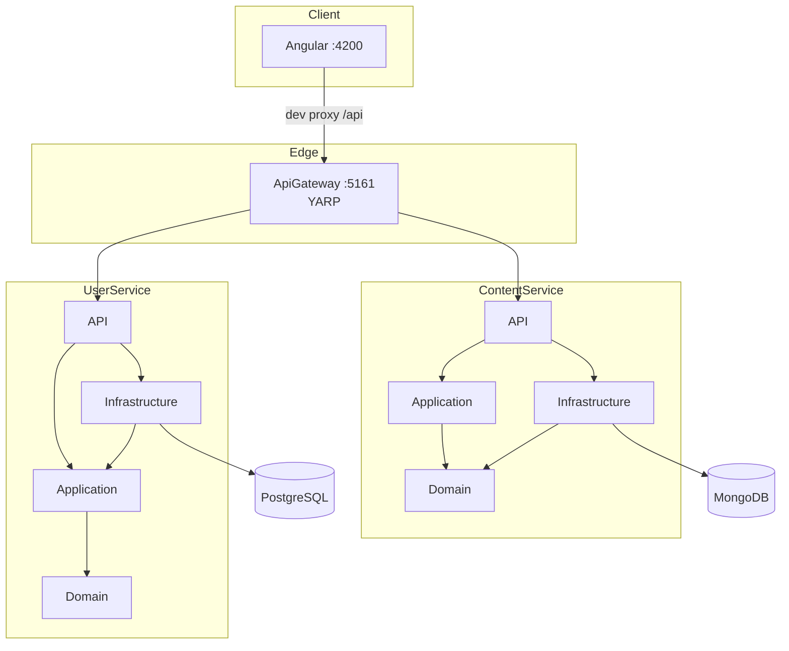
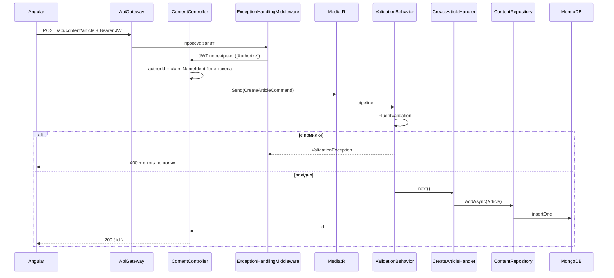
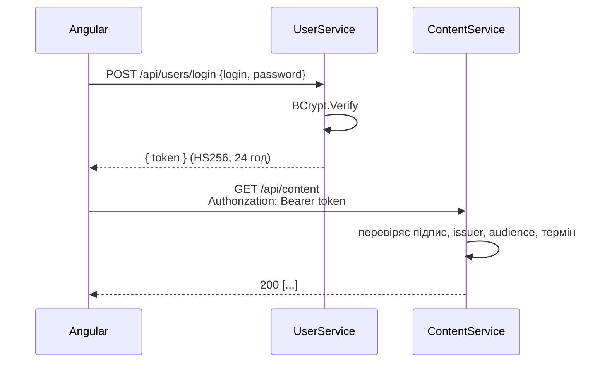

# Архітектура

← [README](../README.md)

## Загальна картина

Система складається з трьох .NET-застосунків і Angular-клієнта.
Сервіси незалежні: у кожного своя база, свій набір проєктів і жодного спільного коду.
Єдине, що їх повʼязує, — **JWT**: UserService його підписує, ContentService перевіряє тим самим секретом.

## Clean Architecture: чотири шари

Кожен сервіс розбитий на чотири проєкти. Залежності спрямовані **всередину**: Domain нічого не знає про інші шари.

| Шар | Що містить | Від чого залежить |
|---|---|---|
| **Domain** | Сутності (`User`, `Article`, `Video`), value objects (`UserId`), інтерфейси репозиторіїв | Ні від чого |
| **Application** | Сценарії використання: команди/запити MediatR, обробники, валідатори, DTO, інтерфейси сервісів (`IJwtTokenGenerator`, `IPasswordHasher`), власні винятки | Domain |
| **Infrastructure** | Реалізації: EF Core / MongoDB репозиторії, генерація JWT, BCrypt, міграції | Domain (+ Application в UserService) |
| **API** | Контролери, middleware, DTO запитів, складання DI у `Program.cs` | Application, Infrastructure |

### Чому Infrastructure UserService посилається на Application

Інтерфейси `IJwtTokenGenerator` і `IPasswordHasher` оголошені в **Application**, бо це потреба сценарію
(«видати токен», «перевірити пароль»), а не домену. Infrastructure їх реалізує, тому має посилатися на Application.
Також `UserRepository` кидає `ConflictException` з Application.

У ContentService Infrastructure реалізує лише `IContentRepository` з Domain, тому посилання на Application не потрібне.

### Правило залежностей на практиці

- Обробник `RegisterUserHandler` хешує пароль через `IPasswordHasher`, а **не** викликає BCrypt напряму.
  Замінити BCrypt на Argon2 = нова реалізація в Infrastructure + один рядок у `Program.cs`.
- Контролери не знають про базу: вони лише перетворюють HTTP-запит на команду й віддають її MediatR.
- Сутності Domain не мають атрибутів EF чи Mongo. Мапінг налаштовано зовні:
  `AppDbContext.OnModelCreating` та `MongoConfig.Register()`.

## CQRS через MediatR

Кожна дія — окремий обʼєкт-повідомлення і окремий обробник:

| Сервіс | Тип | Повідомлення | Повертає |
|---|---|---|---|
| UserService | Command | `RegisterUserCommand(Login, Password, FullName)` | `Guid` (id користувача) |
| UserService | Command | `LoginUserCommand(Login, Password)` | `string` (JWT) |
| ContentService | Command | `CreateArticleCommand(Title, Body, AuthorId)` | `string` (id) |
| ContentService | Command | `CreateVideoCommand(Title, Url, DurationSeconds, AuthorId)` | `string` (id) |
| ContentService | Query | `GetAllContentQuery()` | `List<ContentDto>` |

Тут CQRS «легкий»: команди й запити розділені на рівні коду, але база одна і та сама.

## Потік запиту

На прикладі створення статті:

## Обробка помилок

Обробники **кидають винятки**, а `ExceptionHandlingMiddleware` перетворює їх на HTTP-коди.
Контролери не містять `try/catch`.

| Виняток | Де виникає | HTTP | Тіло |
|---|---|---|---|
| `FluentValidation.ValidationException` | `ValidationBehavior` | **400** | `{ error, errors: { Поле: [повідомлення] } }` |
| `UnauthorizedException` (UserService) | `LoginUserHandler` | **401** | `{ error }` |
| `UnauthorizedAccessException` (ContentService) | у токені немає id користувача | **401** | `{ error }` |
| `ConflictException` (UserService) | логін зайнятий | **409** | `{ error }` |
| будь-який інший | — | **500** | `{ error: "Внутрішня помилка сервера" }`, деталі лише в лог |

401 через відсутній або недійсний токен повертає сам ASP.NET (`[Authorize]` + JwtBearer) без винятку,
тому middleware його не обробляє, а тіло відповіді порожнє.

## Валідація

Двошарова:

1. **Фронтенд** перевіряє форми тими самими правилами, щоб не робити зайвих запитів.
2. **Бекенд** — джерело правди. `ValidationBehavior<TRequest,TResponse>` — це pipeline behavior MediatR:
   перед кожним обробником він знаходить усі `IValidator<TRequest>` і запускає їх.
   Валідатори реєструються автоматично через `AddValidatorsFromAssembly`.

Щоб додати правило, достатньо створити клас `XxxCommandValidator : AbstractValidator<XxxCommand>`
поруч з командою: реєстрація і виклик відбудуться самі.

## Автентифікація

- Обидва сервіси читають `Jwt:Secret`, `Jwt:Issuer`, `Jwt:Audience` з конфігурації (User Secrets).
  **Значення мають збігатися**, інакше ContentService відхилятиме токени.
- Claims у токені: `nameidentifier` (Guid користувача) та `name` (логін).
- ContentService **не звертається** до UserService: токену достатньо, щоб знати, хто робить запит.

## Ключові рішення

| Рішення | Чому |
|---|---|
| Окрема база на сервіс | Сервіси можна розгортати й змінювати незалежно |
| PostgreSQL для користувачів | Потрібен унікальний індекс на логін і строга схема |
| MongoDB для контенту | Різні типи контенту з різними полями в одній колекції |
| Gateway на YARP | Один origin для фронтенду, сервіси не світяться назовні |
| DTO у відповідях замість сутностей | System.Text.Json серіалізує `List<ContentItem>` як базовий клас і губить поля нащадків; DTO також відʼєднує API від моделі зберігання |
| `AuthorId` з токена, а не з тіла | Інакше будь-хто міг би писати від чужого імені |
| Однакове повідомлення для «нема користувача» й «невірний пароль» | Не дає перебором дізнатися, які логіни існують |
| Dev-proxy у фронтенді | Не треба налаштовувати CORS у gateway під час розробки |
