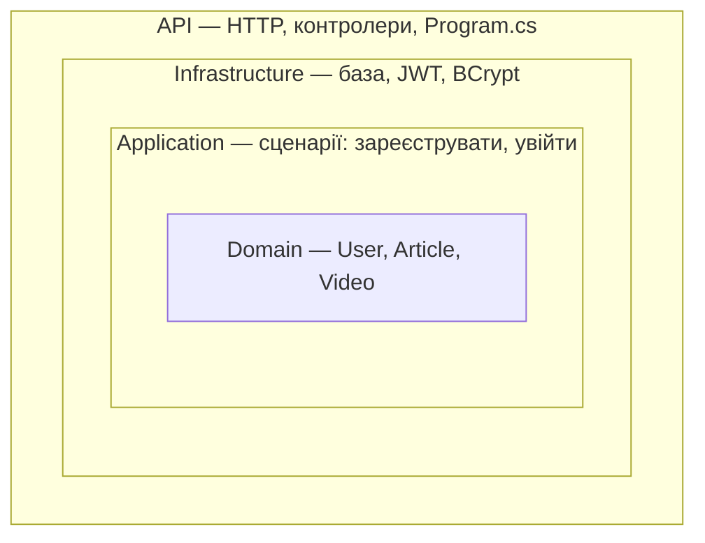
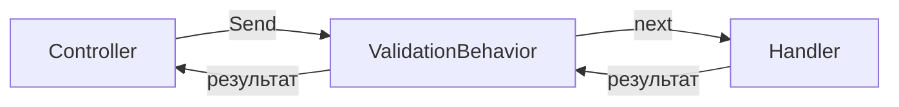
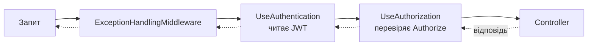
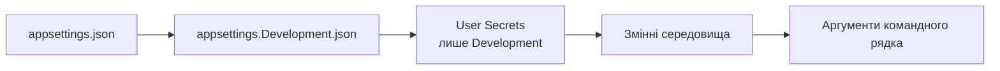

# Концепції простими словами

← [README](../README.md) · далі: [Покроковий розбір коду](walkthrough.md)

Цей документ пояснює **ідеї**, на яких побудований проєкт. Кожна ідея — з прикладом з нашого коду:
що це, навіщо, як виглядає тут і що було б без неї.

Зміст:

1. [Мікросервіси](#1-мікросервіси)
2. [Clean Architecture](#2-clean-architecture)
3. [Dependency Injection](#3-dependency-injection-di)
4. [Репозиторій](#4-репозиторій)
5. [CQRS](#5-cqrs)
6. [MediatR і pipeline behaviors](#6-mediatr-і-pipeline-behaviors)
7. [Валідація з FluentValidation](#7-валідація-з-fluentvalidation)
8. [Middleware](#8-middleware)
9. [Value Object](#9-value-object)
10. [DTO](#10-dto)
11. [JWT](#11-jwt)
12. [Хешування паролів](#12-хешування-паролів)
13. [API Gateway](#13-api-gateway)
14. [ORM і міграції](#14-orm-і-міграції)
15. [Документна база і дискримінатор](#15-документна-база-і-дискримінатор)
16. [Конфігурація і User Secrets](#16-конфігурація-і-user-secrets)
17. [Angular: signals, interceptor-и, guard-и](#17-angular-signals-interceptor-и-guard-и)

---

## 1. Мікросервіси

**Що це.** Замість одного великого застосунку є кілька маленьких. Кожен відповідає за свою область
і має **власну базу даних**. Спілкуються вони лише через мережу (HTTP).

**Як тут.** Є два сервіси:

| | UserService | ContentService |
|---|---|---|
| Відповідає за | хто ти (реєстрація, вхід) | що ти публікуєш |
| База | PostgreSQL | MongoDB |
| Знає про іншого? | ні | ні, лише довіряє JWT |

ContentService **ніколи не звертається** до UserService. Звідки ж він знає, хто автор статті?
З токена: UserService підписав його секретним ключем, ContentService перевіряє підпис тим самим ключем
і просто читає з токена id користувача.

**Навіщо.** Сервіси можна змінювати, перезапускати й масштабувати окремо. Якщо впаде ContentService,
вхід продовжить працювати. Кожен сервіс може взяти зручну саме йому базу.

**Ціна.** Складніше запускати (три процеси, дві бази), немає транзакцій між базами,
дані користувача й контенту не зʼєднати SQL-запитом. Для такого маленького проєкту це навчальний вибір:
моноліт був би простішим.

---

## 2. Clean Architecture

**Що це.** Спосіб розкласти код по шарах так, щоб **бізнес-логіка не залежала від технічних деталей**
(бази даних, фреймворку, HTTP).

Уявіть кола одне в одному:



**Головне правило:** залежність (посилання на проєкт, `using`) може бути спрямована лише **всередину**.

| Шар | Може знати про | Не може знати про |
|---|---|---|
| Domain | нічого | EF Core, Mongo, ASP.NET, MediatR |
| Application | Domain | EF Core, Mongo, ASP.NET, BCrypt |
| Infrastructure | Domain, Application | ASP.NET-контролери |
| API | усе | — |

**Як тут.** Відкрийте `UserService.Domain.csproj`: у ньому **немає жодного** `PackageReference`.
Сутність `User` — звичайний C#-клас без атрибутів бази.

Але Application треба хешувати паролі, а BCrypt — це технічна деталь. Як бути?
**Інверсія залежностей:** Application оголошує, *що* йому потрібно, а Infrastructure вирішує, *як* це зробити.

```csharp
// Application — «мені потрібен хто-небудь, хто вміє хешувати»
public interface IPasswordHasher
{
    string Hash(string password);
    bool Verify(string password, string passwordHash);
}

// Infrastructure — «я вмію, через BCrypt»
public class BCryptPasswordHasher : IPasswordHasher
{
    public string Hash(string password) => BCrypt.Net.BCrypt.HashPassword(password);
    public bool Verify(string password, string passwordHash) => BCrypt.Net.BCrypt.Verify(password, passwordHash);
}

// API (Program.cs) — «зʼєдную одне з іншим»
builder.Services.AddSingleton<IPasswordHasher, BCryptPasswordHasher>();
```

**Навіщо.**
- Замінити BCrypt на інший алгоритм — один новий клас і один рядок у `Program.cs`, сценарії не змінюються.
- Обробник можна протестувати з фейковим `IPasswordHasher`, без справжньої криптографії й бази.
- Бізнес-правила читаються без «шуму» фреймворків.

**Що було б без неї.** Контролер, який сам відкриває зʼєднання з базою, сам хешує пароль і сам формує JWT.
Працює, але будь-яка зміна бази чи бібліотеки зачіпає все.

---

## 3. Dependency Injection (DI)

**Що це.** Клас не створює свої залежності через `new`, а **отримує їх у конструкторі**.
Хто саме їх створить, вирішує DI-контейнер ASP.NET.

```csharp
public class LoginUserHandler
{
    public LoginUserHandler(
        IUserRepository repository,          // хто дасть? контейнер
        IJwtTokenGenerator jwtTokenGenerator,
        IPasswordHasher passwordHasher) { ... }
}
```

Контейнер знає, що підставити, бо в `Program.cs` є реєстрації:

```csharp
builder.Services.AddScoped<IUserRepository, UserRepository>();
builder.Services.AddSingleton<IPasswordHasher, BCryptPasswordHasher>();
```

### Час життя (lifetime)

| Lifetime | Скільки екземплярів | Приклад тут | Чому так |
|---|---|---|---|
| **Singleton** | один на весь застосунок | `IPasswordHasher`, `IJwtTokenGenerator`, `IMongoClient` | без стану або потокобезпечні; `MongoClient` тримає пул зʼєднань |
| **Scoped** | один на HTTP-запит | `AppDbContext`, `IUserRepository`, `IContentRepository` | `DbContext` не потокобезпечний і відстежує зміни в межах запиту |
| **Transient** | новий щоразу | обробники MediatR (так їх реєструє сама бібліотека) | дешеві, без стану |

Валідатори FluentValidation `AddValidatorsFromAssembly` за замовчуванням реєструє як **scoped**.

**Типова помилка:** впровадити scoped-сервіс у singleton. Тоді `DbContext` житиме вічно
і ділитиметься між запитами. ASP.NET у Development кидає виняток при такій спробі.

---

## 4. Репозиторій

**Що це.** Обʼєкт, який виглядає як колекція доменних обʼєктів і ховає, як саме вони зберігаються.

```csharp
public interface IUserRepository   // Domain
{
    Task<User?> GetByLoginAsync(string login, CancellationToken ct = default);
    Task<bool> ExistsByLoginAsync(string login, CancellationToken ct = default);
    Task AddAsync(User user, CancellationToken ct = default);
}
```

Обробник реєстрації знає лише «перевір, чи є такий логін» і «додай користувача».
Чи це PostgreSQL, Mongo або список у памʼяті — не його справа.

**Чому інтерфейс у Domain, а реалізація в Infrastructure** — див. правило залежностей вище.

---

## 5. CQRS

**Що це.** *Command Query Responsibility Segregation* — розділення операцій на два види:

| | Command (команда) | Query (запит) |
|---|---|---|
| Що робить | змінює стан | лише читає |
| Приклад тут | `RegisterUserCommand`, `CreateArticleCommand` | `GetAllContentQuery` |
| Повертає | мінімум: id, токен | дані (DTO) |

**Навіщо.** Кожна дія — окремий маленький клас з однією відповідальністю, а не великий `UserService`
з десятьма методами. Легко знайти, легко тестувати, легко додати поведінку лише до команд (наприклад, аудит).

**Тут — «легкий» CQRS**: розділення лише в коді, база одна. Повний CQRS має окрему модель
(а іноді й окрему базу) для читання.

---

## 6. MediatR і pipeline behaviors

**Що це.** Бібліотека-посередник. Контролер не викликає обробник напряму, а «відправляє повідомлення»,
і MediatR сам знаходить потрібний обробник.

```csharp
// Контролер
var token = await _mediator.Send(new LoginUserCommand(login, password), ct);

// MediatR знаходить
public class LoginUserHandler : IRequestHandler<LoginUserCommand, string> { ... }
```

Звʼязок «команда → обробник» встановлюється за типом: `IRequestHandler<LoginUserCommand, string>`.
Реєструє все `RegisterServicesFromAssembly(...)`.

### Pipeline behaviors

Головна перевага MediatR — можна «обгорнути» **кожен** обробник спільною логікою, як цибулю:



`ValidationBehavior` запускається перед будь-яким обробником, перевіряє команду і, якщо є помилки,
кидає `ValidationException`, і обробник навіть не викликається. Без behavior-а довелося б писати
`validator.Validate(...)` на початку кожного обробника.

Так само можна додати логування часу виконання, транзакції, кешування запитів, не змінюючи жодного обробника.

---

## 7. Валідація з FluentValidation

**Що це.** Правила перевірки описуються окремим класом замість `if`-ів чи атрибутів:

```csharp
public class RegisterUserCommandValidator : AbstractValidator<RegisterUserCommand>
{
    public RegisterUserCommandValidator()
    {
        RuleFor(x => x.Login).NotEmpty().MinimumLength(3).MaximumLength(50);
        RuleFor(x => x.Password).NotEmpty().MinimumLength(8).MaximumLength(100);
        RuleFor(x => x.FullName).NotEmpty().MaximumLength(200);
    }
}
```

- `AddValidatorsFromAssembly(...)` у `Program.cs` знаходить усі валідатори автоматично.
- Повідомлення локалізовані: система українська, тому «'Login' не може бути порожнім».
- Свої правила — через `.Must(...)` з `.WithMessage(...)`, як перевірка URL відео.

**Валідація ≠ бізнес-правила.** «Пароль ≥ 8 символів» — це валідація (форма даних).
«Логін уже зайнятий» — бізнес-правило (потрібна база), тому воно в обробнику і дає 409, а не 400.

---

## 8. Middleware

**Що це.** Ланцюжок функцій, через які проходить **кожен** HTTP-запит в ASP.NET. Кожна ланка може
щось зробити до і після наступної.



Порядок у `Program.cs` = порядок ланцюжка:

```csharp
app.UseMiddleware<ExceptionHandlingMiddleware>();  // першим — щоб ловити все, що нижче
app.UseAuthentication();
app.UseAuthorization();
app.MapControllers();
```

`ExceptionHandlingMiddleware` обгортає решту в `try/catch` і перетворює винятки на коди відповіді.
Завдяки цьому обробник просто пише `throw new ConflictException(...)` і не думає про HTTP.

---

## 9. Value Object

**Що це.** Обʼєкт, який визначається своїм **значенням**, а не ідентичністю. Два `UserId` з однаковим Guid рівні.

```csharp
public readonly record struct UserId(Guid Value)
{
    public static UserId New() => new(Guid.NewGuid());
}
```

**Навіщо.** Якщо всюди `Guid`, компілятор не помітить, що ви передали id статті замість id користувача.
З `UserId` така помилка просто не скомпілюється.

- `record` дає рівність за значенням і `ToString()`.
- `struct` — без виділення памʼяті в купі.
- `readonly` — незмінний.

EF Core зберігає його як звичайний `uuid` завдяки конвертеру в `AppDbContext`.

---

## 10. DTO

**Що це.** *Data Transfer Object* — простий клас лише для передачі даних через межу (HTTP).

Тут є два види:

| Вид | Приклад | Навіщо |
|---|---|---|
| Request DTO | `CreateArticleRequest(Title, Body)` | клієнт не може передати поля, яких немає в DTO, наприклад `authorId` |
| Response DTO | `ContentDto` | клієнт отримує стабільний формат, незалежний від того, як дані лежать у базі |

**Реальний баг, який DTO виправив.** Раніше API повертав `List<ContentItem>`. System.Text.Json серіалізує
за **оголошеним** типом, тобто як `ContentItem`, і поля `Body`, `Url`, `DurationSeconds` просто зникали.
`ContentDto` має всі поля явно, а `ContentDto.From` заповнює їх залежно від типу.

---

## 11. JWT

**Що це.** *JSON Web Token* — рядок з трьох частин, розділених крапками: `заголовок.дані.підпис`.

```
eyJhbGciOiJIUzI1NiIs...   .   eyJodHRwOi8vc2NoZW1h...   .   Xk3f9...
      header (base64)              payload (base64)           signature
```

- **Header** — алгоритм (`HS256`).
- **Payload** — «claims»: id користувача, логін, термін дії, хто видав (`iss`), для кого (`aud`).
- **Signature** — HMAC-SHA256 від перших двох частин із **секретним ключем**.

**Важливо:** payload **не зашифрований**, лише закодований. Будь-хто може його прочитати
(фронтенд так і робить, щоб показати імʼя). Але **підробити** не може: без секрету підпис не зійдеться.
Тому в токен не можна класти паролі чи інші секрети.

**Як сервер перевіряє** (`TokenValidationParameters` у `Program.cs`):

| Перевірка | Що означає |
|---|---|
| `ValidateIssuerSigningKey` | підпис зроблено нашим секретом |
| `ValidateIssuer` | `iss` == `UserService` |
| `ValidateAudience` | `aud` == `MyApp` |
| `ValidateLifetime` | `exp` ще не минув |

**Без стану.** Сервер не зберігає сесій: уся інформація в самому токені.
Мінус — токен не можна «відкликати» до закінчення терміну (24 години).

---

## 12. Хешування паролів

**Що це.** Пароль перетворюється на хеш односторонньою функцією, і в базі лежить лише хеш.
При вході хешується введений пароль і порівнюється.

**Чому BCrypt, а не SHA-256:**

| | SHA-256 | BCrypt |
|---|---|---|
| Швидкість | мільярди за секунду на GPU | навмисно повільний (work factor) |
| Сіль | треба додавати самому | вбудована, своя для кожного пароля |
| Однакові паролі | однакові хеші | різні хеші |

Хеш BCrypt виглядає так: `$2a$11$Q8v...`, де `11` — work factor (2¹¹ ітерацій).

---

## 13. API Gateway

**Що це.** Єдина точка входу для клієнта. Клієнт знає одну адресу, а gateway розподіляє запити по сервісах.

**Навіщо.**
- Клієнту не треба знати, скільки сервісів і де вони.
- Один origin, тож менше проблем з CORS.
- Тут зручно додавати спільне: rate limiting, логування, перевірку JWT.

**YARP** (*Yet Another Reverse Proxy*) — бібліотека Microsoft, де маршрути описуються в конфігурації.
Детально: [ApiGateway](api-gateway.md).

---

## 14. ORM і міграції

**ORM** (*Object-Relational Mapper*) — EF Core перетворює C#-обʼєкти на рядки таблиць і LINQ на SQL:

```csharp
await _context.Users.AnyAsync(u => u.Login == login, ct);
// SQL: SELECT EXISTS (SELECT 1 FROM "Users" WHERE "Login" = @login)
```

**Міграція** — C#-файл з інструкціями, як змінити схему бази (`CreateTable`, `CreateIndex`).
Генерується командою `dotnet ef migrations add` з різниці між моделлю й останнім знімком
(`AppDbContextModelSnapshot.cs`). Дає історію змін схеми в git і однакову схему на всіх машинах.

---

## 15. Документна база і дискримінатор

**MongoDB** зберігає не рядки таблиць, а **JSON-подібні документи**. Документи в одній колекції
можуть мати різні поля, і це ідеально для статей і відео.

Але при читанні драйвер має знати, який C#-клас створити. Для цього він записує поле `_t`:

```json
{ "_id": "…", "_t": ["ContentItem", "Video"], "title": "…", "url": "…", "durationSeconds": 120 }
```

Це **дискримінатор**. Налаштовується в `MongoConfig.Register()`. Детально: [ContentService](content-service.md).

---

## 16. Конфігурація і User Secrets

ASP.NET збирає налаштування з кількох джерел. **Пізніші перекривають попередні:**



- `appsettings.json` лежить у git, тому там **лише порожні заглушки** для секретів.
- **User Secrets** — файл у профілі Windows, поза репозиторієм. Туди кладуться паролі БД і ключ JWT.
- Ключі з `:` — це вкладеність: `Jwt:Secret` = `{ "Jwt": { "Secret": "…" } }`.
  У змінних середовища двокрапка замінюється на `__`: `Jwt__Secret`.

---

## 17. Angular: signals, interceptor-и, guard-и

| Поняття | Що це | Де тут |
|---|---|---|
| **Standalone-компонент** | компонент без NgModule, сам оголошує свої `imports` | усі сторінки |
| **Signal** | реактивна змінна: `count()` читає, `count.set(1)` пише, шаблон оновлюється сам | `loading`, `items`, `tokenSignal` |
| **computed** | signal, обчислений з інших, перераховується автоматично | `visible`, `userName`, `isLoggedIn` |
| **Zoneless** | Angular не відстежує всі асинхронні події, а оновлює шаблон лише за сигналами | тому стан — лише в signals |
| **Interceptor** | функція, через яку проходить кожен HTTP-запит (аналог middleware) | `authInterceptor`, `errorInterceptor` |
| **Guard** | функція, яка вирішує, чи можна відкрити маршрут | `authGuard`, `guestGuard` |
| **Reactive Forms** | форма як обʼєкт у коді з валідаторами | `form = fb.group({...})` |
| **inject()** | DI в Angular без конструктора | `inject(AuthService)` |

Детально: [Фронтенд](frontend.md).
