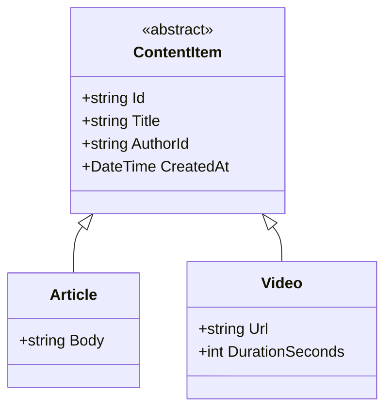

# ContentService

← [README](../README.md) · [Архітектура](architecture.md)

Зберігає контент двох типів: **статті** та **відео**. Усі ендпойнти вимагають JWT.

| | |
|---|---|
| Адреса | http://localhost:5137 (через gateway: http://localhost:5161/api/content) |
| Swagger | http://localhost:5137/swagger (кнопка **Authorize**, вставляти лише токен) |
| База | MongoDB `ContentServiceDb`, колекція `content`, Docker-контейнер `contentplatform-mongo` |
| Ендпойнти | `GET /api/content`, `POST /api/content/article`, `POST /api/content/video` |

## Проєкти та файли

```
src/ContentService/ContentService.Domain/
  Entities/ContentItem.cs           абстрактний базовий клас
  Entities/Article.cs               + Body
  Entities/Video.cs                 + Url, DurationSeconds
  Interfaces/IContentRepository.cs

src/ContentService/ContentService.Application/
  Commands/CreateArticle/           команда, обробник, валідатор
  Commands/CreateVideo/             команда, обробник, валідатор
  Queries/GetAllContent/            запит, обробник
  Dtos/ContentDto.cs                плаский DTO для відповіді
  Behaviors/ValidationBehavior.cs

src/ContentService/ContentService.Infrastructure/
  Persistence/MongoConfig.cs        camelCase + реєстрація ієрархії класів
  Persistence/ContentRepository.cs

src/ContentService/ContentService.API/
  Controllers/ContentController.cs  [Authorize], authorId з токена
  Requests/CreateArticleRequest.cs, CreateVideoRequest.cs
  Middleware/ExceptionHandlingMiddleware.cs
  Program.cs                        Mongo, MediatR, JWT, Swagger з Bearer
```

## Доменна модель



- `Id` — це `Guid` у вигляді рядка, генерується в обробнику (`Guid.NewGuid().ToString()`).
- `AuthorId` — Guid користувача з UserService, рядком. **Звʼязку на рівні бази немає**, бо це інша база.
- `CreatedAt` — UTC.

## Як зберігається в MongoDB

Усі типи лежать в **одній колекції** `content`. Щоб при читанні знати, який клас створити,
драйвер записує **дискримінатор** `_t`:

```json
{
  "_id": "64c0ba33-de1b-4446-88b9-81cad6a6dc5b",
  "_t": ["ContentItem", "Article"],
  "title": "Моя стаття",
  "authorId": "75939ef8-830f-46c4-b811-2932acb84c9f",
  "createdAt": ISODate("2026-11-24T10:02:40.999Z"),
  "body": "Текст"
}
```

Це налаштовує `MongoConfig.Register()`, яку викликають **один раз** на старті (`Program.cs`, перший рядок):

- `CamelCaseElementNameConvention`: `Title` → `title` у базі;
- `ContentItem` позначено як `SetIsRootClass(true)`, тому `_t` — масив з усією ієрархією;
- `Article` і `Video` явно зареєстровані, щоб драйвер знав про нащадків до першого читання.

`Id` автоматично стає `_id` за конвенцією драйвера.

## Відповідь: `ContentDto`

`GET /api/content` повертає не сутності, а плаский DTO:

```json
{
  "id": "…",
  "type": "article",          // "article" | "video" | "unknown"
  "title": "…",
  "authorId": "…",
  "createdAt": "2026-11-24T10:02:40.999Z",
  "body": "…",                 // лише для article, інакше null
  "url": null,                 // лише для video
  "durationSeconds": null      // лише для video
}
```

**Навіщо.** Якщо повертати `List<ContentItem>`, System.Text.Json серіалізує кожен елемент як **базовий** клас,
і `body`, `url`, `durationSeconds` зникають з відповіді. Мапінг робить `ContentDto.From(item)` через `switch` за типом.

## Створення контенту

`authorId` **не приймається** з тіла запиту. Контролер бере його з claim `NameIdentifier` у JWT:

```csharp
private string CurrentUserId =>
    User.FindFirstValue(ClaimTypes.NameIdentifier)
    ?? throw new UnauthorizedAccessException(...);
```

Якщо клієнт надішле `"authorId"` у JSON, поле буде проігноровано, бо в `CreateArticleRequest` / `CreateVideoRequest` його немає.

### Правила валідації

| Команда | Поле | Правило |
|---|---|---|
| Article | `title` | не порожній, до 200 |
| Article | `body` | не порожній |
| Video | `title` | не порожній, до 200 |
| Video | `url` | абсолютний URL зі схемою `http` або `https` |
| Video | `durationSeconds` | більше 0 |
| обидві | `authorId` | не порожній (підставляється з токена) |

## Підключення до MongoDB

`MongoClient` зареєстровано як **singleton**: він потокобезпечний і сам тримає пул зʼєднань.
`IMongoDatabase` теж singleton, `ContentRepository` — scoped.

## Конфігурація (User Secrets)

| Ключ | Приклад |
|---|---|
| `MongoDB:ConnectionString` | `mongodb://localhost:27017` |
| `MongoDB:DatabaseName` | `ContentServiceDb` |
| `Jwt:Secret` / `Jwt:Issuer` / `Jwt:Audience` | **ті самі значення, що в UserService** |

## Відомі особливості

- Записи, створені до виправлення `authorId`, можуть мати довільний `authorId` (наприклад, `"будь-який-текст"`).
  Фронтенд просто не позначатиме їх як «моє».
- Немає пагінації, редагування, видалення й `GET` за id (метод `GetByIdAsync` у репозиторії вже є).
  Див. [Розробка → Що можна покращити](development.md#що-можна-покращити).
