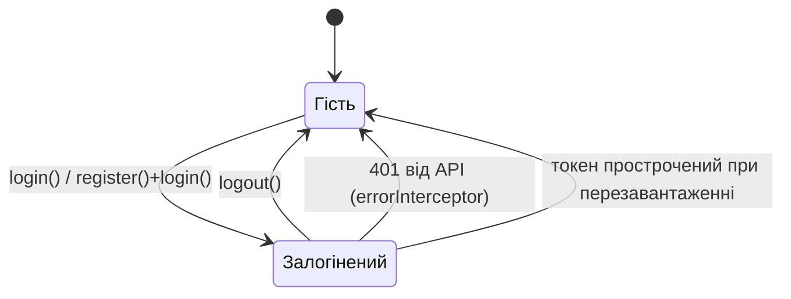

# Фронтенд

← [README](../README.md) · [Архітектура](architecture.md)

Angular 21 застосунок у папці `frontend/`. Сучасний стиль Angular: **standalone-компоненти** (без NgModule),
**signals** для стану, **zoneless** change detection (без zone.js), новий синтаксис шаблонів `@if` / `@for`.

| | |
|---|---|
| Запуск | `cd frontend; npm start` → http://localhost:4200 |
| Збірка | `npx ng build` → `frontend/dist/frontend` |
| Сповіщення | ngx-toastr 20 |
| Звʼязок з бекендом | dev-proxy `/api` → gateway `:5161` |

## Структура

```
frontend/
  proxy.conf.json            /api → http://localhost:5161
  angular.json               стилі toastr, proxyConfig
  src/
    styles.css               глобальні стилі та CSS-змінні (кольори, радіуси)
    app/
      app.config.ts          провайдери: router, HttpClient + interceptor-и, toastr
      app.routes.ts          маршрути та guard-и
      app.ts / app.html      шапка (логін або імʼя + «Вийти») і <router-outlet>
      core/
        models.ts            типи запитів і відповідей API
        auth.service.ts      токен, вхід, реєстрація, вихід, дані з JWT
        content.service.ts   запити до /api/content
        interceptors.ts      authInterceptor, errorInterceptor
        guards.ts            authGuard, guestGuard
      pages/
        login/               форма входу
        register/            форма реєстрації (+ автоматичний вхід)
        content/             список, фільтр «Усе/Моє», форма статті/відео
```

## Маршрути

| Шлях | Сторінка | Guard |
|---|---|---|
| `/login` | Вхід | `guestGuard`: залогіненого перекине на `/content` |
| `/register` | Реєстрація | `guestGuard` |
| `/content` | Контент | `authGuard`: без входу перекине на `/login` |
| `/`, будь-що інше | → `/content` | |

## Автентифікація (`AuthService`)

- Токен зберігається в `localStorage` під ключем `token` і в signal `tokenSignal`.
- При старті застосунку токен перевіряється на `exp`: **прострочений одразу видаляється**,
  тому користувач не бачить себе «залогіненим» з мертвим токеном.
- `userName` і `userId` — `computed` signals, які декодують payload JWT
  (base64url з підтримкою UTF-8, бо логін може бути кирилицею).
- Підпис токена на клієнті **не перевіряється**, це робить сервер.



## Interceptor-и

Зареєстровані в `app.config.ts` у такому порядку: `withInterceptors([authInterceptor, errorInterceptor])`.

**`authInterceptor`** додає `Authorization: Bearer <token>` до кожного запиту, якщо токен є.

**`errorInterceptor`** показує всі помилки API через toastr, тому компонентам не треба обробляти їх самостійно:

| Ситуація | Toast | Додатково |
|---|---|---|
| статус `0` (сервер не відповідає) | ❌ «Немає звʼязку» | |
| `400` з `errors` | ⚠️ список усіх повідомлень по полях | |
| `401` (крім запиту логіну) | ℹ️ «Сесія закінчилась» | `logout()` + перехід на `/login` |
| інше (401 логіну, 409, 500) | ❌ текст з `error` | |

Помилка далі прокидається через `throwError`, щоб компонент міг, наприклад, вимкнути індикатор завантаження.

## Toastr

Налаштування в `app.config.ts`:

```ts
provideToastr({
  positionClass: 'toast-bottom-right',
  timeOut: 4000,
  progressBar: true,
  closeButton: true,
  preventDuplicates: true
})
```

Стилі підключено в `angular.json` → `styles: ["node_modules/ngx-toastr/toastr.css", ...]`.
ngx-toastr 20 **не потребує** `@angular/animations`.

Використання в компоненті:

```ts
private readonly toastr = inject(ToastrService);
this.toastr.success('Статтю опубліковано');
```

## Сторінка «Контент»

- Стан — signals: `items`, `loading`, `saving`, `kind` (`article`/`video`), `filter` (`all`/`mine`).
- `visible` — `computed`: сортує за датою (нові зверху) і фільтрує «Моє» за `authorId === userId`.
- Дві reactive-форми з тими самими правилами, що й на бекенді. Після успішного збереження форма скидається, а список перезавантажується.
- Тривалість відео показується як `хв:сек` (`formatDuration`).

## Чому dev-proxy, а не CORS

Браузер вважає `localhost:4200` і `localhost:5161` різними origin, тож прямі запити блокувалися б без CORS.
`proxy.conf.json` змушує Angular dev-server самому пересилати `/api/*` на gateway, і для браузера все на одному origin.

**Для продакшену** proxy не працює (він є лише в `ng serve`). Варіанти:
віддавати зібраний `dist/` з того ж домену, що й gateway, або увімкнути CORS у gateway (див. [ApiGateway](api-gateway.md)).

## Як додати сторінку

1. Створіть `src/app/pages/xxx/xxx.ts` + `xxx.html` (standalone-компонент, `imports: [...]`).
2. Додайте маршрут у `app.routes.ts` з потрібним guard.
3. Якщо потрібен API, додайте метод у сервіс у `core/`. Токен і помилки обробляться interceptor-ами.
4. Стан тримайте в `signal()`. У zoneless-режимі звичайне поле, змінене в `subscribe`, **не оновить** шаблон.
