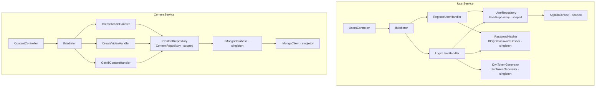

# Program.cs і DI: як сервіси запускаються

← [README](../README.md) · [Концепції → DI](concepts.md#3-dependency-injection-di)

`Program.cs` — точка входу кожного сервісу. Тут **збирається** весь застосунок: що з чим зʼєднано,
які налаштування, який порядок middleware. Якщо щось «не підхоплюється», шукати треба тут.

Файл завжди має дві частини:

```csharp
var builder = WebApplication.CreateBuilder(args);
// 1. builder.Services... — реєстрація сервісів у DI (ще нічого не працює)

var app = builder.Build();
// 2. app.Use... / app.Map... — конвеєр обробки запитів

await app.RunAsync();
```

---

## UserService — `src/UserService/UserService.API/Program.cs`

### База даних

```csharp
builder.Services.AddDbContext<AppDbContext>(options =>
    options.UseNpgsql(builder.Configuration["ConnectionStrings:Default"]));
```

- Реєструє `AppDbContext` як **scoped**, тобто один на HTTP-запит.
- `UseNpgsql` — провайдер PostgreSQL.
- Рядок підключення з User Secrets. Якщо він порожній, сервіс **стартує**, але впаде на першому запиті до бази.

### Репозиторій і паролі

```csharp
builder.Services.AddScoped<IUserRepository, UserRepository>();
builder.Services.AddSingleton<IPasswordHasher, BCryptPasswordHasher>();
```

`UserRepository` scoped, бо залежить від scoped `AppDbContext`. `BCryptPasswordHasher` не має стану, тож singleton.

### Генератор JWT

```csharp
var secret = builder.Configuration["Jwt:Secret"]!;
var issuer = builder.Configuration["Jwt:Issuer"]!;
var audience = builder.Configuration["Jwt:Audience"]!;
builder.Services.AddSingleton<IJwtTokenGenerator>(
    new JwtTokenGenerator(secret, issuer, audience));
```

- `!` (null-forgiving) лише вимикає попередження компілятора, ніякої перевірки не додає.
  Якщо секрет не задано, сервіс **стартує**, а впаде на першому вході (генерація токена) чи першому запиті з токеном:
  ключ для підпису буде порожнім (`""` із заглушки в `appsettings.json`) або `null`.
  Ключ коротший за 32 символи теж дає помилку в цей момент.
- Генератор створюється **вручну** (`new`) і реєструється як готовий екземпляр, бо його конструктор приймає рядки,
  які DI сам не знає, звідки взяти.

### MediatR і валідація

```csharp
var applicationAssembly = typeof(RegisterUserCommand).Assembly;
builder.Services.AddValidatorsFromAssembly(applicationAssembly);
builder.Services.AddMediatR(cfg =>
{
    cfg.RegisterServicesFromAssembly(applicationAssembly);
    cfg.AddOpenBehavior(typeof(ValidationBehavior<,>));
});
```

- `typeof(RegisterUserCommand).Assembly` — спосіб послатися на збірку `UserService.Application`
  через будь-який тип з неї.
- `AddValidatorsFromAssembly` знаходить усі класи `AbstractValidator<T>` і реєструє їх як `IValidator<T>`.
- `RegisterServicesFromAssembly` знаходить усі `IRequestHandler<,>`.
- `AddOpenBehavior(typeof(ValidationBehavior<,>))` — **відкритий generic**: behavior підставляється для
  **будь-якої** пари `<TRequest, TResponse>`.

### Автентифікація

```csharp
builder.Services.AddAuthentication(JwtBearerDefaults.AuthenticationScheme)
    .AddJwtBearer(options => { options.TokenValidationParameters = new() { ... }; });
```

UserService сам не має захищених ендпойнтів, але схема налаштована, щоб можна було додати, наприклад, `GET /api/users/me`.

### Контролери і Swagger

```csharp
builder.Services.AddControllers();           // знайти всі ControllerBase
builder.Services.AddEndpointsApiExplorer();  // метадані ендпойнтів для Swagger
builder.Services.AddSwaggerGen();            // генерація OpenAPI-документа
```

### Конвеєр

```csharp
if (app.Environment.IsDevelopment())
{
    app.UseSwagger();      // /swagger/v1/swagger.json
    app.UseSwaggerUI();    // /swagger
}

app.UseMiddleware<ExceptionHandlingMiddleware>();
app.UseAuthentication();
app.UseAuthorization();
app.MapControllers();
```

**Порядок має значення:**
- `ExceptionHandlingMiddleware` першим, бо він має обгортати все, що нижче.
- `UseAuthentication` перед `UseAuthorization`: спершу «хто ти», потім «чи можна тобі».
- Swagger лише в Development, щоб у продакшені не публікувати опис API.

---

## ContentService — `src/ContentService/ContentService.API/Program.cs`

Відрізняється лише частиною про базу та Swagger.

### Налаштування Mongo до старту

```csharp
MongoConfig.Register();

var builder = WebApplication.CreateBuilder(args);
```

`MongoConfig.Register()` викликається **до** всього іншого, і рівно один раз. Він змінює **глобальний**
стан драйвера (конвенції, карти класів). Повторна реєстрація тієї самої карти класу кинула б виняток.

### MongoDB

```csharp
builder.Services.AddSingleton<IMongoClient>(new MongoClient(mongoConnectionString));
builder.Services.AddSingleton(sp => sp.GetRequiredService<IMongoClient>().GetDatabase(mongoDatabaseName));
builder.Services.AddScoped<IContentRepository, ContentRepository>();
```

- `MongoClient` потокобезпечний і тримає пул зʼєднань, тож один на застосунок, як радить документація драйвера.
- `IMongoDatabase` реєструється через **фабрику** (`sp => ...`): DI сам дістає клієнт і викликає `GetDatabase`.
- Створення `MongoClient` **не підключається** до бази. Зʼєднання відкривається при першому запиті,
  тому сервіс стартує навіть при вимкненому Mongo.

### Swagger з кнопкою Authorize

```csharp
builder.Services.AddSwaggerGen(c =>
{
    c.AddSecurityDefinition("Bearer", new OpenApiSecurityScheme
    {
        Type = SecuritySchemeType.Http,
        Scheme = "bearer",
        BearerFormat = "JWT",
        Description = "Встав лише токен, без слова Bearer"
    });
    c.AddSecurityRequirement(document => new OpenApiSecurityRequirement
    {
        [new OpenApiSecuritySchemeReference("Bearer", document)] = []
    });
});
```

- `AddSecurityDefinition` описує схему, тобто HTTP Bearer. Через `Type = Http` Swagger UI **сам** додає слово `Bearer`.
- `AddSecurityRequirement` застосовує схему до всіх ендпойнтів, тому в кожного зʼявляється замочок.
- Синтаксис з `document => ...` і `OpenApiSecuritySchemeReference` — це API Swashbuckle 10 / Microsoft.OpenApi 2.x.
  У старих статтях буде `new OpenApiSecurityScheme { Reference = new OpenApiReference {...} }`, з новою версією він не скомпілюється.

---

## Карта залежностей DI

Що від чого залежить під час обробки запиту:



## Як ASP.NET знаходить конфігурацію

`WebApplication.CreateBuilder(args)` автоматично читає джерела в такому порядку (пізніші перекривають):

1. `appsettings.json`
2. `appsettings.{Environment}.json` (`Development` з `launchSettings.json`)
3. **User Secrets**, лише якщо середовище Development і в `.csproj` є `UserSecretsId`
4. Змінні середовища (`Jwt__Secret`)
5. Аргументи командного рядка (`--Jwt:Secret=...`)

Середовище задає `ASPNETCORE_ENVIRONMENT` у `Properties/launchSettings.json`:

```json
"http": {
  "commandName": "Project",
  "launchUrl": "swagger",
  "applicationUrl": "http://localhost:5184",
  "environmentVariables": { "ASPNETCORE_ENVIRONMENT": "Development" }
}
```

Якщо запустити зібраний `.dll` без цієї змінної, середовище буде **Production**: User Secrets не підхопляться,
а Swagger буде вимкнено.
