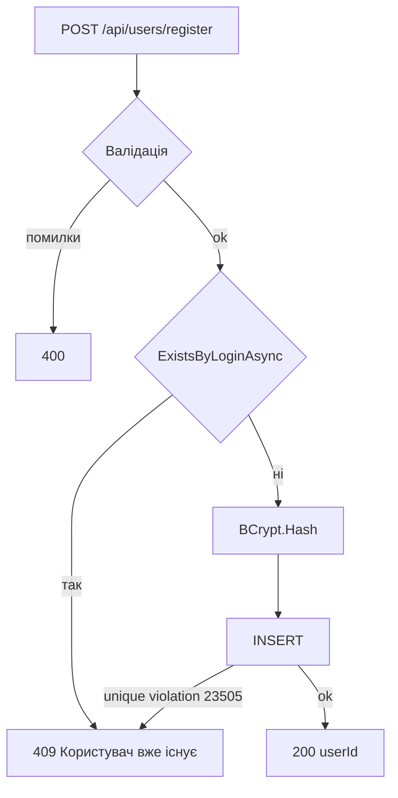

# UserService

← [README](../README.md) · [Архітектура](architecture.md)

Відповідає за користувачів: реєстрацію, вхід і видачу JWT.

| | |
|---|---|
| Адреса | http://localhost:5184 (через gateway: http://localhost:5161/api/users) |
| Swagger | http://localhost:5184/swagger |
| База | PostgreSQL `UserServiceDb`, порт 5433, таблиця `Users` |
| Ендпойнти | `POST /api/users/register`, `POST /api/users/login`, обидва без авторизації |

## Проєкти та файли

```
src/UserService/UserService.Domain/
  Entities/User.cs                  сутність користувача
  ValueObjects/UserId.cs            строго типізований id (обгортка над Guid)
  Interfaces/IUserRepository.cs     контракт сховища

src/UserService/UserService.Application/
  Commands/RegisterUser/            команда, обробник, валідатор
  Commands/LoginUser/               команда, обробник, валідатор
  Interfaces/IJwtTokenGenerator.cs
  Interfaces/IPasswordHasher.cs
  Exceptions/ConflictException.cs   → 409
  Exceptions/UnauthorizedException.cs → 401
  Behaviors/ValidationBehavior.cs   запуск FluentValidation перед обробником

src/UserService/UserService.Infrastructure/
  Persistence/AppDbContext.cs       EF Core, мапінг UserId, унікальний індекс Login
  Persistence/Repositories/UserRepository.cs
  Auth/JwtTokenGenerator.cs         підпис HS256, 24 години
  Auth/BCryptPasswordHasher.cs
  Migrations/                       InitialCreate

src/UserService/UserService.API/
  Controllers/UsersController.cs
  Requests/UserRegistrationRequest.cs, UserLoginRequest.cs
  Middleware/ExceptionHandlingMiddleware.cs
  Program.cs                        DI, JWT, Swagger
```

## Доменна модель

```csharp
public class User
{
    public UserId Id { get; private set; }
    public string Login { get; private set; }
    public string PasswordHash { get; private set; }
    public string FullName { get; private set; }
}

public readonly record struct UserId(Guid Value);
```

- Властивості мають `private set`: змінити користувача можна лише через конструктор (або майбутні методи сутності).
- Приватний конструктор без параметрів потрібен лише EF Core.
- `UserId` — **value object**: компілятор не дасть випадково передати id статті туди, де очікується id користувача.
  EF зберігає його як звичайний `uuid` завдяки `HasConversion` в `AppDbContext`.

## Таблиця `Users`

| Колонка | Тип | Примітка |
|---|---|---|
| `Id` | `uuid` | PK |
| `Login` | `text` | **унікальний індекс** `IX_Users_Login` |
| `PasswordHash` | `text` | BCrypt-хеш, пароль у відкритому вигляді не зберігається |
| `FullName` | `text` | |

## Реєстрація



**Правила валідації** (`RegisterUserCommandValidator`):

| Поле | Правило |
|---|---|
| `login` | не порожній, 3–50 символів |
| `password` | не порожній, 8–100 символів |
| `fullName` | не порожній, до 200 символів |

**Подвійний захист від дублікатів.** Спочатку обробник перевіряє `ExistsByLoginAsync`. Але два одночасні запити
можуть обидва пройти перевірку. Тоді спрацює унікальний індекс у PostgreSQL, і `UserRepository` перехопить
`PostgresException` з кодом `23505` (`UniqueViolation`) та перетворить його на `ConflictException` → **409**.

## Вхід

1. Валідація: `login` і `password` не порожні.
2. `GetByLoginAsync` шукає користувача.
3. `IPasswordHasher.Verify` порівнює пароль з хешем.
4. Якщо користувача немає **або** пароль невірний, виникає `UnauthorizedException("Невірний логін або пароль")` → **401**.
   Повідомлення однакове навмисно, див. [Архітектура → Ключові рішення](architecture.md#ключові-рішення).
5. Інакше `JwtTokenGenerator.GenerateToken(user)` → `200 { token }`.

## JWT

| Параметр | Значення |
|---|---|
| Алгоритм | HS256 (симетричний ключ) |
| Ключ | `Jwt:Secret` — **щонайменше 32 символи**, інакше бібліотека кине виняток |
| Issuer / Audience | `Jwt:Issuer` / `Jwt:Audience` |
| Термін дії | 24 години |
| Claims | `http://schemas.xmlsoap.org/ws/2005/05/identity/claims/nameidentifier` = Guid користувача<br/>`http://schemas.xmlsoap.org/ws/2005/05/identity/claims/name` = логін |

Довгі імена claims — так `JwtSecurityTokenHandler` записує `ClaimTypes.NameIdentifier` і `ClaimTypes.Name`.
Фронтенд читає саме їх (`auth.service.ts`).

Refresh-токенів немає: через 24 години потрібно увійти знову.

## Конфігурація

Зберігається в **User Secrets** (`UserSecretsId` у `UserService.API.csproj`), у `appsettings.json` лише порожні заглушки.

| Ключ | Приклад |
|---|---|
| `ConnectionStrings:Default` | `Host=localhost;Port=5433;Database=UserServiceDb;Username=postgres;Password=...` |
| `Jwt:Secret` | рядок ≥ 32 символів, **такий самий, як у ContentService** |
| `Jwt:Issuer` | `UserService` |
| `Jwt:Audience` | `MyApp` |

Як задати секрети і працювати з міграціями: [Розробка](development.md).
