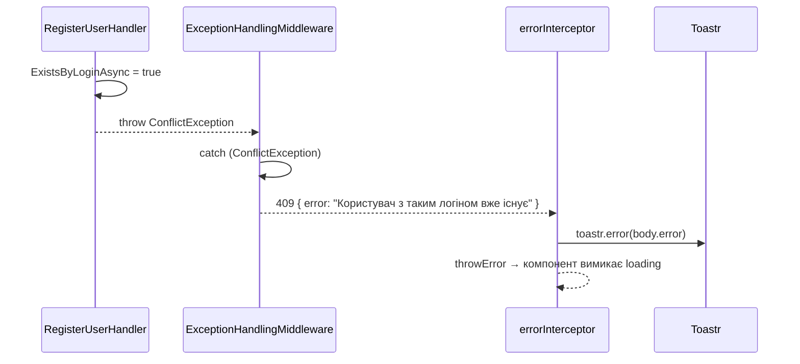

# Покроковий розбір коду

← [Концепції](concepts.md) · [README](../README.md)

Тут ми проходимо **чотири реальні сценарії** від кнопки в браузері до запису в базі.
На кожному кроці вказано файл, показано код і пояснено, що відбувається.

Зміст:

1. [Реєстрація](#сценарій-1-реєстрація)
2. [Вхід](#сценарій-2-вхід)
3. [Створення статті](#сценарій-3-створення-статті)
4. [Отримання списку контенту](#сценарій-4-отримання-списку-контенту)
5. [Що відбувається при помилці](#що-відбувається-при-помилці)

---

## Сценарій 1. Реєстрація

Користувач заповнює форму «Реєстрація» і натискає кнопку.

### Крок 1. Форма — `frontend/src/app/pages/register/register.ts`

```ts
protected readonly form = inject(NonNullableFormBuilder).group({
  login: ['', [Validators.required, Validators.minLength(3), Validators.maxLength(50)]],
  password: ['', [Validators.required, Validators.minLength(8), Validators.maxLength(100)]],
  fullName: ['', [Validators.required, Validators.maxLength(200)]]
});

submit(): void {
  if (this.form.invalid) {
    this.form.markAllAsTouched();   // показати підказки під полями
    return;                         // запит не відправляємо
  }
  const { login, password } = this.form.getRawValue();
  this.loading.set(true);

  this.auth
    .register(this.form.getRawValue())
    .pipe(switchMap(() => this.auth.login({ login, password })))   // одразу входимо
    .subscribe({
      next: () => {
        this.toastr.success('Акаунт створено, ти вже увійшов', 'Готово');
        this.router.navigate(['/content']);
      },
      error: () => this.loading.set(false)
    });
}
```

- `NonNullableFormBuilder`: після `reset()` поля стають `''`, а не `null`, тому типи простіші.
- Правила збігаються з бекендом, тож очевидні помилки ловляться без запиту.
- `switchMap`: коли реєстрація успішна, відразу запускається вхід. Користувачу не треба вводити дані двічі.
- `error` лише вимикає індикатор, бо toast покаже `errorInterceptor`.

### Крок 2. HTTP-запит — `core/auth.service.ts`

```ts
register(request: RegisterRequest): Observable<string> {
  return this.http
    .post<{ userId: string }>('/api/users/register', request)
    .pipe(map(r => r.userId));
}
```

Шлях відносний: `/api/...`. Браузер шле його на `localhost:4200`.

### Крок 3. Interceptor-и — `core/interceptors.ts`

Запит проходить `authInterceptor` (токена ще немає, тож заголовок не додається) і `errorInterceptor`
(він лише слухає відповідь).

### Крок 4. Dev-proxy — `frontend/proxy.conf.json`

```json
{ "/api": { "target": "http://localhost:5161", "changeOrigin": true } }
```

Angular dev-server бачить `/api/...` і пересилає запит на gateway.

### Крок 5. Gateway — `src/ApiGateway/appsettings.json`

`/api/users/register` збігається з `/api/users/{**catch-all}`, тож запит іде в `user-cluster` → `http://localhost:5184`.

### Крок 6. Middleware — `src/UserService/UserService.API/Program.cs`

```
ExceptionHandlingMiddleware → UseAuthentication → UseAuthorization → контролер
```

Ендпойнт без `[Authorize]`, тож автентифікація нічого не блокує.

### Крок 7. Контролер — `src/UserService/UserService.API/Controllers/UsersController.cs`

```csharp
[HttpPost("register")]
public async Task<IActionResult> Register(
    [FromBody] UserRegistrationRequest request,
    CancellationToken cancellationToken)
{
    var userId = await _mediator.Send(request.ToCommand(), cancellationToken);
    return Ok(new { userId });
}
```

- `[ApiController]` на класі: JSON з тіла автоматично десеріалізується в `UserRegistrationRequest`.
- `CancellationToken`: якщо клієнт закриє зʼєднання, запит до бази буде скасовано.
- `request.ToCommand()` перетворює HTTP-DTO на команду Application.
  Так API-шар може змінювати формат запиту, не чіпаючи команду.

### Крок 8. Валідація — `src/UserService/UserService.Application/Behaviors/ValidationBehavior.cs`

```csharp
if (validators.Any())
{
    var context = new ValidationContext<TRequest>(request);
    var results = await Task.WhenAll(validators.Select(v => v.ValidateAsync(context, cancellationToken)));
    var failures = results.SelectMany(r => r.Errors).Where(f => f is not null).ToList();

    if (failures.Count > 0)
        throw new ValidationException(failures);
}
return await next(cancellationToken);
```

MediatR викликає behavior **перед** обробником. Він отримує всі валідатори для `RegisterUserCommand`
(тут один, `RegisterUserCommandValidator`), запускає їх і або кидає виняток, або передає далі (`next`).

### Крок 9. Обробник — `src/UserService/UserService.Application/Commands/RegisterUser/RegisterUserHandler.cs`

```csharp
public async Task<Guid> Handle(RegisterUserCommand request, CancellationToken ct)
{
    if (await _repository.ExistsByLoginAsync(request.Login, ct))
        throw new ConflictException("Користувач з таким логіном вже існує");

    var userId = UserId.New();
    var passwordHash = _passwordHasher.Hash(request.Password);
    var user = new User(userId, request.Login, passwordHash, request.FullName);

    await _repository.AddAsync(user, ct);
    return userId.Value;
}
```

Тут уся **бізнес-логіка** реєстрації, і жодного SQL, BCrypt чи HTTP. Лише інтерфейси.

### Крок 10. Репозиторій — `src/UserService/UserService.Infrastructure/Persistence/Repositories/UserRepository.cs`

```csharp
public async Task AddAsync(User user, CancellationToken ct = default)
{
    await _context.Users.AddAsync(user, ct);
    try
    {
        await _context.SaveChangesAsync(ct);
    }
    catch (DbUpdateException ex) when (ex.InnerException is PostgresException { SqlState: PostgresErrorCodes.UniqueViolation })
    {
        throw new ConflictException("Користувач з таким логіном вже існує");
    }
}
```

- `AddAsync` лише позначає обʼєкт як «новий», а `SaveChangesAsync` виконує `INSERT`.
- `catch ... when (...)` — **фільтр винятків**: ловимо лише порушення унікальності, решта летить далі.
  Це страховка для двох одночасних реєстрацій з одним логіном.

### Крок 11. Відповідь

`200 { "userId": "…" }` іде назад тим самим шляхом. Фронтенд одразу викликає вхід (сценарій 2).

---

## Сценарій 2. Вхід

### Обробник — `src/UserService/UserService.Application/Commands/LoginUser/LoginUserHandler.cs`

```csharp
var user = await _repository.GetByLoginAsync(request.Login, cancellationToken);

if (user is null || !_passwordHasher.Verify(request.Password, user.PasswordHash))
    throw new UnauthorizedException("Невірний логін або пароль");

return _jwtTokenGenerator.GenerateToken(user);
```

Одна умова на обидва випадки. Якби повідомлення відрізнялись, перебором можна було б дізнатися,
які логіни зареєстровані.

### Генерація токена — `src/UserService/UserService.Infrastructure/Auth/JwtTokenGenerator.cs`

```csharp
var claims = new[]
{
    new Claim(ClaimTypes.NameIdentifier, user.Id.Value.ToString()),
    new Claim(ClaimTypes.Name, user.Login)
};

var key = new SymmetricSecurityKey(Encoding.UTF8.GetBytes(_secret));
var creds = new SigningCredentials(key, SecurityAlgorithms.HmacSha256);

var token = new JwtSecurityToken(
    issuer: _issuer,
    audience: _audience,
    claims: claims,
    expires: DateTime.UtcNow.AddHours(24),
    signingCredentials: creds);

return new JwtSecurityTokenHandler().WriteToken(token);
```

### Збереження на фронтенді — `core/auth.service.ts`

```ts
login(request: LoginRequest): Observable<void> {
  return this.http.post<{ token: string }>('/api/users/login', request).pipe(
    tap(r => {
      localStorage.setItem(TOKEN_KEY, r.token);   // переживе перезавантаження сторінки
      this.tokenSignal.set(r.token);              // миттєво оновить шапку й guard-и
    }),
    map(() => undefined)
  );
}

readonly userName = computed(() => this.payload()?.[NAME_CLAIM] ?? '');
```

Після `tokenSignal.set(...)` усе, що залежить від сигналу (`isLoggedIn`, `userName`, шапка), оновлюється само.

---

## Сценарій 3. Створення статті

### Крок 1. Токен у запиті — `core/interceptors.ts`

```ts
export const authInterceptor: HttpInterceptorFn = (req, next) => {
  const token = inject(AuthService).token();
  return next(token ? req.clone({ setHeaders: { Authorization: `Bearer ${token}` } }) : req);
};
```

HTTP-запити в Angular незмінні, тому `clone` створює копію з новим заголовком.

### Крок 2. Перевірка токена — `src/ContentService/ContentService.API/Program.cs`

```csharp
options.TokenValidationParameters = new TokenValidationParameters
{
    ValidateIssuer = true,
    ValidateAudience = true,
    ValidateLifetime = true,
    ValidateIssuerSigningKey = true,
    ValidIssuer = issuer,
    ValidAudience = audience,
    IssuerSigningKey = new SymmetricSecurityKey(Encoding.UTF8.GetBytes(secret))
};
```

`UseAuthentication()` читає заголовок, перевіряє підпис і термін, а з claims токена створює `HttpContext.User`.
Контролер має `[Authorize]`, тож без валідного токена запит отримає 401 і далі не піде.

### Крок 3. Контролер — `src/ContentService/ContentService.API/Controllers/ContentController.cs`

```csharp
private string CurrentUserId =>
    User.FindFirstValue(ClaimTypes.NameIdentifier)
    ?? throw new UnauthorizedAccessException("У токені немає ідентифікатора користувача");

[HttpPost("article")]
public async Task<IActionResult> CreateArticle([FromBody] CreateArticleRequest request, CancellationToken ct)
{
    var id = await _mediator.Send(request.ToCommand(CurrentUserId), ct);
    return Ok(new { id });
}
```

```csharp
public record CreateArticleRequest(string Title, string Body)
{
    public CreateArticleCommand ToCommand(string authorId) => new(Title, Body, authorId);
}
```

**Ключовий момент безпеки:** у `CreateArticleRequest` **немає** `AuthorId`. Автор береться лише з токена,
який підписав сервер. Підставити чужий id неможливо.

### Крок 4. Обробник — `src/ContentService/ContentService.Application/Commands/CreateArticle/CreateArticleHandler.cs`

```csharp
var article = new Article
{
    Id = Guid.NewGuid().ToString(),
    Title = request.Title,
    Body = request.Body,
    AuthorId = request.AuthorId,
    CreatedAt = DateTime.UtcNow
};

await _repository.AddAsync(article, cancellationToken);
return article.Id;
```

### Крок 5. Запис у Mongo — `src/ContentService/ContentService.Infrastructure/Persistence/ContentRepository.cs`

```csharp
_collection = database.GetCollection<ContentItem>("content");

public async Task AddAsync(ContentItem item, CancellationToken ct = default)
    => await _collection.InsertOneAsync(item, null, ct);
```

Колекція типізована базовим класом `ContentItem`, але драйвер бачить, що насправді передано `Article`,
і записує дискримінатор `_t: ["ContentItem", "Article"]` разом з полем `body`.

### Крок 6. Фронтенд після успіху — `pages/content/content.ts`

```ts
next: () => {
  this.toastr.success(this.kind() === 'article' ? 'Статтю опубліковано' : 'Відео додано');
  form.reset();
  this.saving.set(false);
  this.load();          // перезавантажити список
}
```

---

## Сценарій 4. Отримання списку контенту

### Обробник — `src/ContentService/ContentService.Application/Queries/GetAllContent/GetAllContentHandler.cs`

```csharp
var items = await _repository.GetAllAsync(cancellationToken);
return items.Select(ContentDto.From).ToList();
```

### Читання — `ContentRepository.GetAllAsync`

```csharp
await _collection.Find(_ => true).ToListAsync(ct);
```

Драйвер читає `_t` кожного документа і створює `Article` або `Video`. Саме тому `MongoConfig.Register()`
заздалегідь реєструє обидва класи.

### Мапінг у DTO — `src/ContentService/ContentService.Application/Dtos/ContentDto.cs`

```csharp
public static ContentDto From(ContentItem item) => item switch
{
    Article a => new(a.Id, "article", a.Title, a.AuthorId, a.CreatedAt, Body: a.Body),
    Video v => new(v.Id, "video", v.Title, v.AuthorId, v.CreatedAt, Url: v.Url, DurationSeconds: v.DurationSeconds),
    _ => new(item.Id, "unknown", item.Title, item.AuthorId, item.CreatedAt)
};
```

**Pattern matching** (`Article a =>`) перевіряє тип і одразу дає змінну потрібного типу.
Іменовані аргументи (`Body: a.Body`) заповнюють лише потрібні необовʼязкові параметри.

### Відображення — `pages/content/content.ts` і `content.html`

```ts
protected readonly visible = computed(() => {
  const list = [...this.items()].sort((a, b) => b.createdAt.localeCompare(a.createdAt));
  return this.filter() === 'mine' ? list.filter(i => i.authorId === this.auth.userId()) : list;
});
```

```html
@for (item of visible(); track item.id) {
  ...
} @empty {
  <p>Поки що порожньо.</p>
}
```

- Сортування рядків ISO-дат працює правильно, бо формат `2026-11-24T10:02:40Z` сортується лексикографічно.
- `[...this.items()]` — копія масиву, бо `sort` змінює масив на місці, а стан signal-у змінювати напряму не можна.
- `track item.id` — Angular перемальовує лише змінені елементи.

---

## Що відбувається при помилці

На прикладі повторної реєстрації з зайнятим логіном:



**Бекенд** — `src/UserService/UserService.API/Middleware/ExceptionHandlingMiddleware.cs`:

```csharp
catch (ConflictException ex)
{
    await WriteAsync(context, StatusCodes.Status409Conflict, new { error = ex.Message });
}
catch (Exception ex)
{
    _logger.LogError(ex, "Unhandled exception");
    await WriteAsync(context, StatusCodes.Status500InternalServerError, new { error = "Внутрішня помилка сервера" });
}
```

Порядок `catch` важливий: специфічні винятки йдуть першими, загальний `Exception` останнім.

**Фронтенд** — `core/interceptors.ts`:

```ts
if (err.status === 0) {
  toastr.error('Сервер недоступний...', 'Немає звʼязку');
} else if (err.status === 400 && body?.errors) {
  const messages = Object.values(body.errors).flat();
  toastr.warning(messages.join('<br>'), body.error ?? 'Помилка валідації', { enableHtml: true });
} else if (err.status === 401 && !req.url.includes('/api/users/login')) {
  auth.logout();
  router.navigate(['/login']);
} else {
  toastr.error(body?.error ?? `Помилка ${err.status}`, 'Помилка');
}
return throwError(() => err);
```

401 на запит **логіну** — це «невірний пароль», а не «сесія закінчилась», тому для нього окрема гілка не спрацьовує
і показується звичайна помилка.
